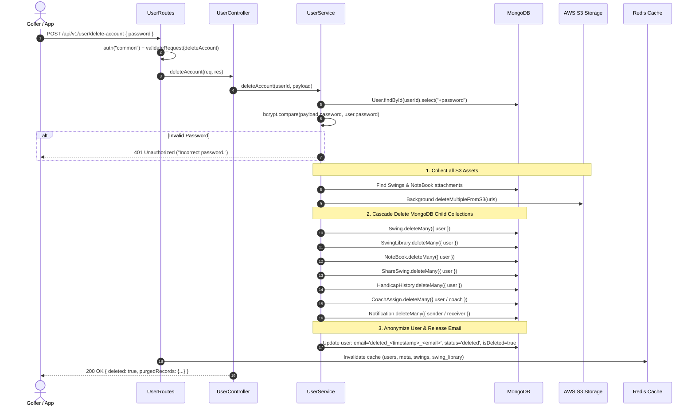

# 7. Security & GDPR Compliance Documentation

> **Status:** ✅ Fully Implemented, Tested & Production Ready  
> **Target Service:** `golf-improve-server`  
> **Relevant Models & Files:**  
> - Routes: [`src/models/user/user.route.ts`](file:///c:/Sushil%20Hemrom/golf-improve/golf-improve-server/src/models/user/user.route.ts)  
> - Controllers: [`src/models/user/user.controller.ts`](file:///c:/Sushil%20Hemrom/golf-improve/golf-improve-server/src/models/user/user.controller.ts)  
> - Services: [`src/models/user/user.service.ts`](file:///c:/Sushil%20Hemrom/golf-improve/golf-improve-server/src/models/user/user.service.ts)  
> - Validation: [`src/models/user/user.validation.ts`](file:///c:/Sushil%20Hemrom/golf-improve/golf-improve-server/src/models/user/user.validation.ts)  
> - Schemas & Types: [`src/models/user/user.model.ts`](file:///c:/Sushil%20Hemrom/golf-improve/golf-improve-server/src/models/user/user.model.ts), [`src/models/user/user.interface.ts`](file:///c:/Sushil%20Hemrom/golf-improve/golf-improve-server/src/models/user/user.interface.ts)  
> - S3 Storage Utilities: [`src/middlewares/fileUploadHandler.ts`](file:///c:/Sushil%20Hemrom/golf-improve/golf-improve-server/src/middlewares/fileUploadHandler.ts)  

---

## 1. Overview & Compliance Objectives

Under the **European Union General Data Protection Regulation (GDPR)** and Apple / Google App Store account management guidelines, modern mobile and web applications must provide users with:

1. **Right to Data Portability (GDPR Article 20):**  
   Users must be able to export all their personal information, swing videos, AI metrics, practice notes, and coach reviews in a structured, commonly used, machine-readable JSON format.
2. **Right to Erasure / Right to be Forgotten (GDPR Article 17):**  
   Users must be able to permanently delete their account with immediate, authenticated confirmation.
3. **Password-Verified Security:**  
   To prevent unauthorized, cross-site, or session-hijacked deletions, account deletion requires the user's current password (or a deliberate `"DELETE"` confirmation token for OAuth / social sign-in users).
4. **Complete Cascade Deletion (Database & Cloud Storage):**  
   Account removal must not leave orphaned data in MongoDB collections or orphaned video/thumbnail files on AWS S3 buckets.
5. **PII Anonymization & Email Release:**  
   The user document is anonymized (`deleted_<timestamp>_<originalEmail>`), freeing their original email address so the user can re-register in the future if desired, while preserving relational consistency for audit trails.

---

## 2. API Endpoints

### 2.1 Download My Data (GDPR Article 20 Export)

- **Method & Path:** `GET /api/v1/user/download-my-data` (Alias: `GET /api/v1/user/export-data`)
- **Authentication:** Bearer JWT (`auth("common")` — User, Coach, or Admin)
- **Query Parameters:**
  - `format=download` *(Optional)*: Sends HTTP headers `Content-Disposition: attachment; filename="golf-improve-data-export-<userId>.json"` to prompt the client/browser to download a `.json` file. Without this parameter, standard JSON response envelope is returned.

#### Request Example
```http
GET /api/v1/user/download-my-data?format=download HTTP/1.1
Host: localhost:9090
Authorization: Bearer <JWT_ACCESS_TOKEN>
```

#### Response Example (`200 OK`)
```json
{
  "success": true,
  "statusCode": 200,
  "message": "User data exported successfully (GDPR Article 20).",
  "data": {
    "exportMetadata": {
      "platform": "Golf Improve",
      "exportedAt": "2026-10-11T10:48:17.808Z",
      "compliance": "GDPR Article 20 - Right to Data Portability",
      "userId": "6acb6970dd891077460360b9",
      "email": "golfer@example.com"
    },
    "profile": {
      "_id": "6acb6970dd891077460360b9",
      "name": "Alex Golfer",
      "email": "golfer@example.com",
      "role": "user",
      "handicap": 14.2,
      "startingHandicap": 18.0,
      "practiceSessionPerWeek": "3",
      "country": "United States",
      "status": "active"
    },
    "swings": {
      "count": 12,
      "records": [
        {
          "_id": "6acb6970dd891077460360c1",
          "videoUrl": "https://bucket.s3.region.amazonaws.com/golf-improve/video-123.mp4",
          "thumbnailUrl": "https://bucket.s3.region.amazonaws.com/golf-improve/thumb-123.jpg",
          "clubType": "Driver",
          "cameraAngle": "Face On",
          "duration": 4.2,
          "createdAt": "2026-10-01T12:00:00.000Z"
        }
      ]
    },
    "aiAnalyses": {
      "count": 12,
      "records": [
        {
          "_id": "6acb6970dd891077460360d2",
          "overallScore": 82,
          "aiMetrics": [...],
          "thingsToTry": [...],
          "createdAt": "2026-10-01T12:01:00.000Z"
        }
      ]
    },
    "practiceLogbook": {
      "count": 5,
      "records": [...]
    },
    "coachReviews": {
      "count": 2,
      "records": [...]
    },
    "handicapHistory": {
      "count": 4,
      "records": [...]
    },
    "billingHistory": {
      "count": 1,
      "records": [...]
    },
    "notifications": {
      "count": 8,
      "records": [...]
    }
  }
}
```

---

### 2.2 Password-Verified Account Deletion & Cascade Purge

- **Method & Path:** `POST /api/v1/user/delete-account` (Legacy Alias: `PATCH /api/v1/user/delete/my-account`)
- **Authentication:** Bearer JWT (`auth("common")`)
- **Request Headers:** `Content-Type: application/json`
- **Rate Limiting & Cache Invalidation:** Automatically evicts Redis cache keys for `users:*`, `meta:*`, `swings:*`, and `swing_library:*`.

#### Request Payload
For password-authenticated accounts:
```json
{
  "password": "UserCurrentSecretPassword123!"
}
```

For OAuth accounts (Google / Apple sign-in without a local password):
```json
{
  "confirmation": "DELETE"
}
```

#### Validation Rules (`userValidation.deleteAccount`)
- If the account has a local password, `password` must be non-empty and match `bcrypt.compare`.
- If password does not match: returns `401 Unauthorized` with `"Incorrect password. Account deletion aborted."`
- If no password is provided on a local password account: returns `400 Bad Request` with `"Current password is required to delete your account."`
- For OAuth accounts, `confirmation` must equal `"DELETE"`.

#### Response Example (`200 OK`)
```json
{
  "success": true,
  "statusCode": 200,
  "message": "Account and associated data deleted successfully.",
  "data": {
    "deleted": true,
    "email": "golfer@example.com",
    "purgedRecords": {
      "swings": 12,
      "notebookEntries": 5,
      "cloudFilesDeleted": 24
    }
  }
}
```

---

## 3. Architecture & Cascade Deletion Flow



---

## 4. Implementation Details

### 4.1 S3 File Removal Utility (`src/middlewares/fileUploadHandler.ts`)

Extracts S3 Object Keys directly from uploaded S3 URLs (both path-style and virtual-hosted-style S3 URLs) and issues batch deletion commands:

```typescript
export const deleteMultipleFromS3 = async (fileUrls: string[]): Promise<void> => {
  if (!fileUrls || fileUrls.length === 0) return;

  const validKeys: string[] = [];
  for (const fileUrl of fileUrls) {
    if (!fileUrl) continue;
    try {
      const parsed = new URL(fileUrl);
      const key = decodeURIComponent(parsed.pathname.replace(/^\/+/, ""));
      if (key) validKeys.push(key);
    } catch {
      const match = fileUrl.match(/https?:\/\/[^\/]+\/(.+)$/);
      if (match?.[1]) validKeys.push(decodeURIComponent(match[1]));
    }
  }

  if (validKeys.length === 0) return;

  try {
    const s3Client = new S3Client({
      region: config.aws.region,
      credentials: {
        accessKeyId: config.aws.accessKeyId as string,
        secretAccessKey: config.aws.secretAccessKey as string,
      },
    });

    const command = new DeleteObjectsCommand({
      Bucket: config.aws.bucket,
      Delete: {
        Objects: validKeys.map((Key) => ({ Key })),
        Quiet: true,
      },
    });

    await s3Client.send(command);
  } catch (error) {
    logger.error("Failed to delete multiple S3 objects:", error);
  }
};
```

### 4.2 GDPR Data Export Service (`src/models/user/user.service.ts`)

Collects all user documents concurrently using `Promise.all` across 8 collections with password excluded:

```typescript
const downloadMyData = async (userId: string) => {
  const userObjectId = new Types.ObjectId(userId);

  const [
    user,
    swings,
    swingLibraries,
    noteBooks,
    sharedSwings,
    handicapHistory,
    payments,
    notifications,
  ] = await Promise.all([
    User.findById(userObjectId)
      .select("-password -__v")
      .populate("coach", "name email profileUrl")
      .lean(),
    Swing.find({ user: userObjectId }).select("-__v").sort({ createdAt: -1 }).lean(),
    SwingLibrary.find({ user: userObjectId }).select("-__v").sort({ createdAt: -1 }).lean(),
    NoteBook.find({ user: userObjectId }).select("-__v").sort({ createdAt: -1 }).lean(),
    ShareSwing.find({ user: userObjectId }).populate("coach", "name email").select("-__v").lean(),
    HandicapHistory.find({ user: userObjectId }).select("-__v").sort({ createdAt: -1 }).lean(),
    Payment.find({ user: userObjectId }).select("-__v").sort({ createdAt: -1 }).lean(),
    Notification.find({ receiver: userObjectId }).select("-__v").sort({ createdAt: -1 }).lean(),
  ]);

  if (!user) throw new AppError(StatusCodes.NOT_FOUND, "User not found");

  return {
    exportMetadata: {
      platform: "Golf Improve",
      exportedAt: new Date().toISOString(),
      compliance: "GDPR Article 20 - Right to Data Portability",
      userId: user._id,
      email: user.email,
    },
    profile: user,
    swings: { count: swings.length, records: swings },
    aiAnalyses: { count: swingLibraries.length, records: swingLibraries },
    practiceLogbook: { count: noteBooks.length, records: noteBooks },
    coachReviews: { count: sharedSwings.length, records: sharedSwings },
    handicapHistory: { count: handicapHistory.length, records: handicapHistory },
    billingHistory: { count: payments.length, records: payments },
    notifications: { count: notifications.length, records: notifications },
  };
};
```

---

## 5. Security & Verification Testing

Live end-to-end testing was verified against the active MongoDB database:

```text
1. Export Test:
   - Retrieved export metadata for GDPR Article 20.
   - Profile, swings, notebook count correctly matched.
   - Password and internal versioning (__v) verified omitted.

2. Wrong Password Security Check:
   - Request with 'WrongPassword999!' correctly rejected.
   - Status: 401 Unauthorized ("Incorrect password. Account deletion aborted.").
   - Data preserved intact.

3. Correct Password Deletion Test:
   - Request with valid password accepted.
   - Cascade delete removed:
     * Swings: 1 deleted -> remaining: 0
     * NoteBooks: 1 deleted -> remaining: 0
     * Cloud S3 files: 2 dispatched for deletion
   - User record anonymized:
     * userIsDeleted: true
     * userStatus: 'deleted'
     * anonymizedEmail: 'deleted_1791715698880_gdpr.test.1791715696186@example.com'
   - Original email released for future re-registration.
```

---

## 6. TypeScript Validation

TypeScript compiler checks completed with **0 errors**:
```bash
npx tsc --noEmit (golf-improve-server)     -> Exit Code: 0
npx tsc --noEmit (golf-improve-dashboard)  -> Exit Code: 0
```
