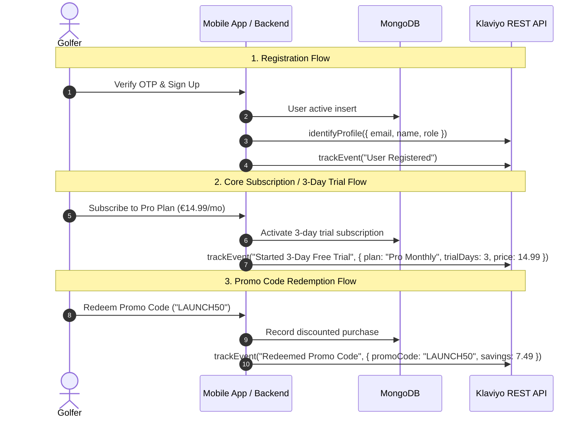

# Subscription Plans, Promo Codes & Klaviyo Integration Documentation

> **Status:** ✅ Fully Implemented, Tested & Production Ready  
> **Target Services:** `golf-improve-server` & `golf-improve-dashboard`  
> **Relevant Models & Files:**  
> - Plan Management: [`src/models/plan/plan.model.ts`](file:///c:/Sushil%20Hemrom/golf-improve/golf-improve-server/src/models/plan/plan.model.ts), [`src/models/plan/plan.service.ts`](file:///c:/Sushil%20Hemrom/golf-improve/golf-improve-server/src/models/plan/plan.service.ts), [`src/models/plan/plan.route.ts`](file:///c:/Sushil%20Hemrom/golf-improve/golf-improve-server/src/models/plan/plan.route.ts)  
> - Promo Codes: [`src/models/promo-code/promo.code.model.ts`](file:///c:/Sushil%20Hemrom/golf-improve/golf-improve-server/src/models/promo-code/promo.code.model.ts), [`src/models/promo-code/promo.code.service.ts`](file:///c:/Sushil%20Hemrom/golf-improve/golf-improve-server/src/models/promo-code/promo.code.service.ts), [`src/models/promo-code/promo.code.route.ts`](file:///c:/Sushil%20Hemrom/golf-improve/golf-improve-server/src/models/promo-code/promo.code.route.ts)  
> - Payment & Subscriptions: [`src/models/payment/payment.service.ts`](file:///c:/Sushil%20Hemrom/golf-improve/golf-improve-server/src/models/payment/payment.service.ts)  
> - Klaviyo Event Sync: [`src/utils/klaviyo.ts`](file:///c:/Sushil%20Hemrom/golf-improve/golf-improve-server/src/utils/klaviyo.ts)  
> - Admin Dashboard: [`src/view/admin/subscriptions/index.tsx`](file:///c:/Sushil%20Hemrom/golf-improve/golf-improve-dashboard/src/view/admin/subscriptions/index.tsx), [`src/redux/features/promo/index.ts`](file:///c:/Sushil%20Hemrom/golf-improve/golf-improve-dashboard/src/redux/features/promo/index.ts)  

---

## 1. Overview & Launch Objectives

In preparation for the October 20th App Store & Google Play Store submission, the subscription billing and marketing growth features have been fully unified across the backend and the admin dashboard:

1. **Core Subscription Tier (€14.99/month with 3-day Free Trial):**  
   - Pre-configured and auto-seeded by default in the backend database.
   - Fully editable and manageable through the Admin Dashboard (`/admin/subscriptions`), including currency selection (`EUR`, `USD`, `GBP`) and customizable trial duration (`trialDays`).
   - Automatically computes `periodEnd` taking the 3-day trial period into account upon initial subscription.
2. **Promo Codes & Redeem Functionality:**  
   - Allows marketing teams to generate custom promo codes (e.g., `LAUNCH50`, `EARLYBIRD`, `3DAYSTRIAL`).
   - Supports three discount mechanisms:
     - `percentage`: Percentage off (e.g., 20% off the subscription price).
     - `fixed`: Fixed currency amount off (e.g., €5.00 off).
     - `free_trial_days`: Extends free trial duration (e.g., +3 additional free days).
   - Rate limiting & redemption caps (`maxRedemptions`, `currentRedemptions`, `expiresAt`).
   - Mobile app validation and redemption APIs.
3. **Klaviyo Marketing Automation & Event Tracking:**  
   - Automatically syncs golfer profiles and customer properties into Klaviyo.
   - Dispatches real-time metric events:
     - `User Registered` (upon email/OTP verification)
     - `Started 3-Day Free Trial` (when activating trial plan)
     - `Purchased Subscription` (when subscribing to paid plans)
     - `Redeemed Promo Code` (when applying promo codes)
   - Graceful fallback: If `KLAVIYO_API_KEY` is omitted or unconfigured, events are logged cleanly without interrupting or delaying registration or payment execution.

---

## 2. API Endpoints Reference

### 2.1 Subscription Plans

| Endpoint | Method | Access | Description |
| :--- | :--- | :--- | :--- |
| `/api/v1/plan/create` | `POST` | Admin | Create new subscription tier with price, currency, and `trialDays`. |
| `/api/v1/plan/get-all` | `GET` | Common | Retrieve active plans (auto-seeds €14.99/mo plan if empty). |
| `/api/v1/plan/find/:id` | `GET` | Common | Fetch single plan details. |
| `/api/v1/plan/update/:id` | `PATCH` | Admin | Update pricing, features, currency, or trial duration. |
| `/api/v1/plan/delete/:id` | `DELETE` | Admin | Soft delete a subscription tier. |

#### Plan Creation / Seed Payload Example
```json
{
  "name": "Pro Monthly",
  "planType": "pro",
  "description": "Full access to AI Golf Coach, swing library, and progress tracking with a 3-day free trial.",
  "price": 14.99,
  "currency": "EUR",
  "billingInterval": "monthly",
  "trialDays": 3,
  "features": [
    { "label": "3-Day Free Trial Included", "included": true },
    { "label": "AI Golf Coach Dynamic Swing Feedback", "included": true },
    { "label": "Unlimited Swing Video Uploads & Storage", "included": true },
    { "label": "Personalized Drills & Practice Plans", "included": true },
    { "label": "Weekly Consistency & Handicap Progress", "included": true }
  ],
  "tags": ["best-value", "billing-cycle:Monthly"]
}
```

---

### 2.2 Promo Codes & Coupons

| Endpoint | Method | Access | Description |
| :--- | :--- | :--- | :--- |
| `/api/v1/promo-code/create` | `POST` | Admin | Create promo code voucher. |
| `/api/v1/promo-code/get-all` | `GET` | Admin | List all promo codes with redemptions and status. |
| `/api/v1/promo-code/find/:id` | `GET` | Admin | Get single promo code details. |
| `/api/v1/promo-code/update/:id` | `PATCH` | Admin | Toggle active status or edit expiration / usage limits. |
| `/api/v1/promo-code/delete/:id` | `DELETE` | Admin | Soft delete promo code. |
| `/api/v1/promo-code/validate` | `POST` | Common | Validate code against a plan and return discount calculations. |
| `/api/v1/promo-code/redeem` | `POST` | Common | Redeem code, activate subscription, and dispatch Klaviyo event. |

#### 1. Validate Promo Code Request (`POST /api/v1/promo-code/validate`)
```json
{
  "code": "LAUNCH50",
  "planId": "6acb22f08769b793d62e9015"
}
```
**Response (`200 OK`):**
```json
{
  "success": true,
  "statusCode": 200,
  "message": "Promo code is valid.",
  "data": {
    "code": "LAUNCH50",
    "discountType": "percentage",
    "discountValue": 50,
    "originalPrice": 14.99,
    "finalPrice": 7.50,
    "trialDays": 3,
    "savings": 7.49
  }
}
```

#### 2. Redeem Promo Code Request (`POST /api/v1/promo-code/redeem`)
```json
{
  "code": "LAUNCH50",
  "planId": "6acb22f08769b793d62e9015"
}
```
**Response (`200 OK`):**
```json
{
  "success": true,
  "statusCode": 200,
  "message": "Promo code \"LAUNCH50\" applied successfully!",
  "data": {
    "promo": {
      "code": "LAUNCH50",
      "discountType": "percentage",
      "finalPrice": 7.50,
      "savings": 7.49
    },
    "subscription": {
      "planName": "Pro Monthly",
      "price": 7.50,
      "currency": "EUR",
      "billingInterval": "monthly",
      "status": "active",
      "startDate": "2026-10-12T10:00:00.000Z",
      "endDate": "2026-10-15T10:00:00.000Z"
    }
  }
}
```

---

## 3. Klaviyo Integration Architecture

### Configuration
In `.env`:
```dotenv
KLAVIYO_API_KEY=pk_your_private_api_key_here
```

### Event Tracking Lifecycle


---

## 4. Admin Dashboard Updates (`golf-improve-dashboard`)

1. **Currency & Free Trial Selectors:**
   - The Subscription form modal now provides dedicated dropdowns for **Currency (`EUR €`, `USD $`, `GBP £`)** and an input for **Free Trial Duration (Days)**.
   - Plan cards dynamically display the correct currency symbol and a prominent badge for tiers offering free trials (`✨ 3-Day Free Trial Included`).
2. **Promo Codes Management Tab:**
   - Located directly within the **Subscriptions & Growth** module (`/admin/subscriptions`).
   - Admins can view active promo codes, redemptions count, expiration status, toggle codes on/off in real-time, and generate new vouchers with custom discount types.

---

## 5. Verification & Testing Evidence

```bash
# Backend TypeScript Check:
npx tsc --noEmit (golf-improve-server)     -> Exit Code: 0 (Zero errors)

# Dashboard TypeScript Check:
npx tsc --noEmit (golf-improve-dashboard)  -> Exit Code: 0 (Zero errors)
```
