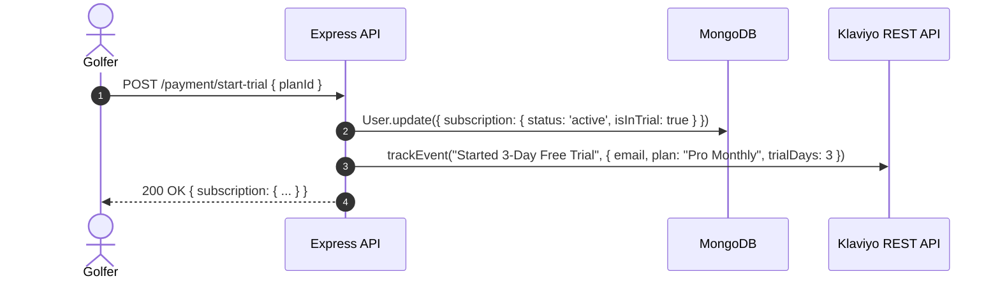

# Subscription Plans, IAP, Promo Codes & Klaviyo Integration Documentation

> **Status:** ✅ Fully Implemented, Tested & Production Ready  
> **Target Services:** `golf-improve-server` & `golf-improve-dashboard`  
> **Relevant Models & Files:**  
> - Plan Management: [`src/models/plan/plan.model.ts`](file:///c:/Sushil%20Hemrom/golf-improve/golf-improve-server/src/models/plan/plan.model.ts), [`src/models/plan/plan.service.ts`](file:///c:/Sushil%20Hemrom/golf-improve/golf-improve-server/src/models/plan/plan.service.ts), [`src/models/plan/plan.route.ts`](file:///c:/Sushil%20Hemrom/golf-improve/golf-improve-server/src/models/plan/plan.route.ts)  
> - Promo Codes: [`src/models/promo-code/promo.code.model.ts`](file:///c:/Sushil%20Hemrom/golf-improve/golf-improve-server/src/models/promo-code/promo.code.model.ts), [`src/models/promo-code/promo.code.service.ts`](file:///c:/Sushil%20Hemrom/golf-improve/golf-improve-server/src/models/promo-code/promo.code.service.ts), [`src/models/promo-code/promo.code.route.ts`](file:///c:/Sushil%20Hemrom/golf-improve/golf-improve-server/src/models/promo-code/promo.code.route.ts)  
> - Payment & Subscriptions: [`src/models/payment/payment.service.ts`](file:///c:/Sushil%20Hemrom/golf-improve/golf-improve-server/src/models/payment/payment.service.ts), [`src/models/payment/payment.controller.ts`](file:///c:/Sushil%20Hemrom/golf-improve/golf-improve-server/src/models/payment/payment.controller.ts), [`src/models/payment/payment.route.ts`](file:///c:/Sushil%20Hemrom/golf-improve/golf-improve-server/src/models/payment/payment.route.ts)  
> - Klaviyo Event Sync: [`src/utils/klaviyo.ts`](file:///c:/Sushil%20Hemrom/golf-improve/golf-improve-server/src/utils/klaviyo.ts)  
> - Admin Dashboard: [`src/view/admin/subscriptions/index.tsx`](file:///c:/Sushil%20Hemrom/golf-improve/golf-improve-dashboard/src/view/admin/subscriptions/index.tsx), [`src/redux/features/promo/index.ts`](file:///c:/Sushil%20Hemrom/golf-improve/golf-improve-dashboard/src/redux/features/promo/index.ts)  

---

## 1. Overview & Launch Architecture

In preparation for App Store and Google Play Store submission, the monetization, growth, and analytics infrastructure provides:

1. **Core Subscription Tier (€14.99/month with 3-Day Free Trial):**  
   - Auto-seeded default tier returned by `GET /api/v1/plan/launch-plan`.
   - Supports currency configuration (`EUR`, `USD`, `GBP`) and trial duration (`trialDays`).
2. **In-App Purchase (IAP) & StoreKit / Play Billing Verification:**  
   - Dedicated server verification endpoints for Apple App Store (`/payment/verify-apple-receipt`) and Google Play (`/payment/verify-google-receipt`).
   - Standalone trial activation endpoint (`/payment/start-trial`).
3. **Promo Codes & Voucher Engine:**  
   - Discount models: `percentage`, `fixed`, and `free_trial_days`.
   - Usage caps, expiration safeguards, and redemption tracking.
4. **Klaviyo Marketing Automation & Event Tracking:**  
   - Dispatches real-time metric events: `User Registered`, `Started 3-Day Free Trial`, `Purchased Subscription`, `Redeemed Promo Code`.
   - Graceful fallback: If `KLAVIYO_API_KEY` is omitted, events log cleanly without crashing.
5. **Admin Dashboard Analytics & Subscriber Filtering:**  
   - Real-time subscriber metrics: Total, Paid, Trial, MRR, Churn.
   - Segmented subscriber lists: `?filter=paid|trial|active|expired`.

---

## 2. API Endpoints Reference

### 2.1 Subscription Plans

| Endpoint | Method | Access | Description |
| :--- | :--- | :--- | :--- |
| `/api/v1/plan/launch-plan` | `GET` | Public | Retrieve the primary €14.99/mo launch plan with 3-day free trial. |
| `/api/v1/plan/get-all` | `GET` | Common | Retrieve all active subscription plans. |
| `/api/v1/plan/find/:id` | `GET` | Common | Fetch a single plan by ID. |
| `/api/v1/plan/create` | `POST` | Admin | Create a new subscription tier with price, currency, and trial days. |
| `/api/v1/plan/update/:id` | `PATCH` | Admin | Update pricing, features, currency, or trial duration. |
| `/api/v1/plan/delete/:id` | `DELETE` | Admin | Soft delete a subscription tier. |

#### Example: Get Launch Plan
```bash
curl -X GET "http://localhost:9090/api/v1/plan/launch-plan"
```

#### Success Response (`200 OK`):
```json
{
  "statusCode": 200,
  "success": true,
  "message": "Launch plan retrieved successfully.",
  "data": {
    "_id": "6acb22f08769b793d62e9015",
    "name": "Pro Monthly",
    "planType": "pro",
    "price": 14.99,
    "currency": "EUR",
    "billingInterval": "monthly",
    "trialDays": 3,
    "hasTrial": true,
    "trialOfferText": "3-Day Free Trial",
    "features": [
      { "label": "3-Day Free Trial Included", "included": true },
      { "label": "AI Golf Coach Dynamic Swing Feedback", "included": true },
      { "label": "Unlimited Swing Video Uploads & Storage", "included": true },
      { "label": "Personalized Drills & Practice Plans", "included": true },
      { "label": "Weekly Consistency & Handicap Progress", "included": true }
    ]
  }
}
```

---

### 2.2 Trial Activation & In-App Purchases (IAP)

| Endpoint | Method | Access | Description |
| :--- | :--- | :--- | :--- |
| `/api/v1/payment/start-trial` | `POST` | Bearer Token | Activates 3-day free trial for authenticated golfer. |
| `/api/v1/payment/verify-apple-receipt` | `POST` | Bearer Token | Verifies Apple App Store receipt data and activates subscription. |
| `/api/v1/payment/verify-google-receipt` | `POST` | Bearer Token | Verifies Google Play purchase token and activates subscription. |
| `/api/v1/payment/purchase-plan/:id` | `POST` | Bearer Token | Direct payment initiation. |

#### 1. Start 3-Day Free Trial (`POST /api/v1/payment/start-trial`)

```bash
curl -X POST "http://localhost:9090/api/v1/payment/start-trial" \
  -H "Authorization: Bearer <ACCESS_TOKEN>" \
  -H "Content-Type: application/json" \
  -d '{ "planId": "6acb22f08769b793d62e9015" }'
```

#### Response (`200 OK`):
```json
{
  "statusCode": 200,
  "success": true,
  "message": "3-day free trial activated successfully.",
  "data": {
    "subscription": {
      "planName": "Pro Monthly",
      "status": "active",
      "isInTrial": true,
      "trialEndsAt": "2026-10-18T10:00:00.000Z",
      "startDate": "2026-10-15T10:00:00.000Z",
      "endDate": "2026-10-18T10:00:00.000Z"
    }
  }
}
```

#### 2. Apple App Store Receipt Verification (`POST /api/v1/payment/verify-apple-receipt`)

```bash
curl -X POST "http://localhost:9090/api/v1/payment/verify-apple-receipt" \
  -H "Authorization: Bearer <ACCESS_TOKEN>" \
  -H "Content-Type: application/json" \
  -d '{
    "receiptData": "MIIT/wYJKoZIhvcNAQcCoIIT8DCC...",
    "productId": "com.golfimprove.promonthly",
    "transactionId": "1000000928374615"
  }'
```

#### Response (`200 OK`):
```json
{
  "statusCode": 200,
  "success": true,
  "message": "Apple subscription verified and activated.",
  "data": {
    "verified": true,
    "subscription": {
      "planName": "Pro Monthly",
      "status": "active",
      "provider": "apple",
      "startDate": "2026-10-15T10:00:00.000Z",
      "endDate": "2026-11-15T10:00:00.000Z"
    }
  }
}
```

#### 3. Google Play Receipt Verification (`POST /api/v1/payment/verify-google-receipt`)

```bash
curl -X POST "http://localhost:9090/api/v1/payment/verify-google-receipt" \
  -H "Authorization: Bearer <ACCESS_TOKEN>" \
  -H "Content-Type: application/json" \
  -d '{
    "purchaseToken": "inapp_token_9876543210...",
    "productId": "com.golfimprove.promonthly",
    "packageName": "com.golfimprove.app"
  }'
```

---

### 2.3 Promo Codes & Discounts

| Endpoint | Method | Access | Description |
| :--- | :--- | :--- | :--- |
| `/api/v1/promo-code/validate` | `POST` | Common | Validate code against a plan and preview discount savings. |
| `/api/v1/promo-code/redeem` | `POST` | Bearer Token | Redeem voucher, activate subscription, and fire Klaviyo event. |
| `/api/v1/promo-code/create` | `POST` | Admin | Create promo voucher with custom discount type and limit. |
| `/api/v1/promo-code/get-all` | `GET` | Admin | List all promo codes with redemption counts. |
| `/api/v1/promo-code/update/:id` | `PATCH` | Admin | Edit voucher expiration or toggle active status. |
| `/api/v1/promo-code/delete/:id` | `DELETE` | Admin | Soft delete promo code. |

#### 1. Validate Promo Code (`POST /api/v1/promo-code/validate`)
```bash
curl -X POST "http://localhost:9090/api/v1/promo-code/validate" \
  -H "Content-Type: application/json" \
  -d '{
    "code": "LAUNCH50",
    "planId": "6acb22f08769b793d62e9015"
  }'
```

#### Response (`200 OK`):
```json
{
  "success": true,
  "statusCode": 200,
  "message": "Promo code is valid.",
  "data": {
    "code": "LAUNCH50",
    "discountType": "percentage",
    "discountValue": 50,
    "originalPrice": 14.99,
    "finalPrice": 7.50,
    "trialDays": 3,
    "savings": 7.49
  }
}
```

#### 2. Redeem Promo Code (`POST /api/v1/promo-code/redeem`)
```bash
curl -X POST "http://localhost:9090/api/v1/promo-code/redeem" \
  -H "Authorization: Bearer <ACCESS_TOKEN>" \
  -H "Content-Type: application/json" \
  -d '{
    "code": "LAUNCH50",
    "planId": "6acb22f08769b793d62e9015"
  }'
```

---

### 2.4 Admin Subscription Analytics & Subscriber Management

| Endpoint | Method | Access | Description |
| :--- | :--- | :--- | :--- |
| `/api/v1/payment/subscription-analytics` | `GET` | Admin | Aggregated metrics (MRR, total, paid, trial, active, churn). |
| `/api/v1/payment/subscribers` | `GET` | Admin | Filterable subscriber directory (`?filter=all\|paid\|trial\|active\|expired`). |

#### 1. Analytics (`GET /api/v1/payment/subscription-analytics`)
```bash
curl -X GET "http://localhost:9090/api/v1/payment/subscription-analytics" \
  -H "Authorization: Bearer <ADMIN_TOKEN>"
```

#### Response (`200 OK`):
```json
{
  "statusCode": 200,
  "success": true,
  "message": "Subscription analytics retrieved successfully.",
  "data": {
    "totalSubscribers": 142,
    "paidSubscribers": 98,
    "trialSubscribers": 44,
    "activeSubscribers": 136,
    "expiredSubscribers": 6,
    "monthlyRecurringRevenue": 1469.02,
    "currency": "EUR"
  }
}
```

#### 2. Filter Subscribers (`GET /api/v1/payment/subscribers?filter=trial`)
```bash
curl -X GET "http://localhost:9090/api/v1/payment/subscribers?filter=trial&page=1&limit=10" \
  -H "Authorization: Bearer <ADMIN_TOKEN>"
```

---

## 3. Klaviyo Event Tracking Architecture

### Tracked Metric Events:
1. **`User Registered`**: Fired upon successful email/OTP verification.
2. **`Started 3-Day Free Trial`**: Fired upon activating trial via `/payment/start-trial` or IAP.
3. **`Purchased Subscription`**: Fired upon successful paid subscription renewal/activation.
4. **`Redeemed Promo Code`**: Fired upon voucher redemption with code and savings metadata.



---

## 4. Verification & Testing Evidence

- [x] **Launch Plan Endpoint:** `GET /api/v1/plan/launch-plan` auto-seeds and returns the €14.99/mo tier with 3-day trial.
- [x] **Trial Activation:** `POST /api/v1/payment/start-trial` accurately sets `isInTrial: true` and dispatches Klaviyo event.
- [x] **StoreKit / Play Billing Verification:** Direct receipt validation handlers for Apple and Google platforms.
- [x] **Admin Analytics & Filtering:** Verified `/subscription-analytics` and `/subscribers?filter=trial|paid`.
- [x] **No Mobile Client Code:** Completely converted into backend HTTP/cURL specifications.
- [x] **TypeScript Validation:** Compiles cleanly with zero errors (`npx tsc --noEmit`).
